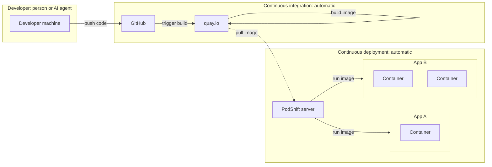

# Documentation of PodShift

PodShift is a lightweight container orchestration enabler for small servers. It installs on Fedora Server and turns it into a complete, self-managing rootless Podman host, with security, networking and monitoring included. It adds no runtime of its own: it switches on and wires together what the system already provides, such as systemd, Podman, Quadlets, firewalld and SELinux.

Applications are described as Quadlet files, small configuration files that run a container as a regular system service. The same Quadlet works on a developer's own computer and on the server. When the image is built in a registry such as quay.io, pushing a new version is enough: the server picks it up, updates the container, and can roll back if it fails.

The same configuration is used from the first day of development through test and staging up to production. Only the environment tag (`TSV_ENV`) and the server's addresses differ. Because nothing depends on a particular provider, the same setup runs on bare metal, on any virtual machine, at any hosting provider or in-house, and can be moved or split between them.

PodShift is meant for small and medium teams running a few containerized apps across a few environments, without a cluster, a cloud platform or a dedicated operations team. To understand its boundaries, start with [Scope](scope.md). To install and operate it, see [Usage](usage.md).

## From Push to Production

You push code. Everything after that is automatic.

1. **Development.** You, or an AI agent, write code and push it to a code platform, here GitHub. If you run PodShift on your local test environment, you can try the app there first, with the same Quadlet files the server will use.
2. **Continuous integration.** The container registry, here quay.io, builds a new image from the code and stores it. PodShift isn't part of this step.
3. **Continuous deployment.** Podman on the server checks the registry regularly, and you can change how often to suit your needs. When a new image is there, Podman pulls it and restarts the app. If the updated app is broken, Podman goes back to the previous version.

**What PodShift does.** PodShift doesn't run your containers, Podman and systemd do. PodShift sets up the server so that all of this just works, and gives you a drop folder: put an app's Quadlet files there, and PodShift checks them and hands them over to Podman as services. After that, every push follows the same path without you.

**One server, many apps.** Each app is one or more containers on its own private network, so apps don't see each other.

**Use any provider.** GitHub and quay.io are just examples. Any similar code platform or container registry works, including a private one. We recommend quay.io because it's free, has plenty of features, and builds images from your code automatically.

Commit in, running app out.

## Content

- [Design Choices](./design-choices.md) - the factors guiding decisions behind PodShift.
- [Project Scope](scope.md) - the project's goal, principles, and what is out of scope.
- [Coding Style and Principles](coding.md) - the shell conventions and bashdoc tags every contribution follows.
- [Testing](../src/test/readme.md) - how the build and install are verified.
- [Usage Instructions](usage.md) - installing and operating a PodShift server.
- [Cockpit API](./cockpit-api.md) - the local JSON handler used by the Cockpit UI ([cockpit-podshift](https://github.com/vellamo-dev/cockpit-podshift)), and how to add an action.
- [Forking](forking.md) - the rules and responsibilities for forks.
- [Security](../security.md) - the security policy and how to report a problem.
- [Support](support.md) - how issues are handled and how to get more help.
- [Roadmap](./roadmap.md) - what PodShift does today and what is planned.

## Why PodShift

PodShift is not magic. Everything it does, you could build yourself on any Fedora server with Podman: the parts are standard, open and well documented. What PodShift adds is experience. It comes from years of running real servers, and it ties that practice together into a set of scripts and configurations that turn a fresh server into a ready continuous deployment machine in minutes, instead of days of research, trial and error.

### You get a ready, secure server in one step

- **Hours of setup become one install.** A complete container server, with security, networking and monitoring, is ready after a single command, and you can safely run it again or update it later.
- **You are secure without being a security expert.** Proven protections are on from the start: key-only SSH, protection against repeated login attempts, a firewall that opens only what is needed, and SELinux.
- **Your apps never run with more power than they need.** Everything runs as one unprivileged user, never as root, yet your apps can still serve web traffic directly.
- **Your own settings are always respected.** Updates to PodShift never overwrite changes you have made.

### Your apps reach production faster, with less risk

- **What works on your computer works in production.** The same configuration runs unchanged from the first day of development through test and staging to production, so surprises between environments disappear.
- **Releasing becomes a push, not a project.** With a registry such as quay.io building your image, pushing a new version is all it takes: your servers pick it up and update on their own.
- **A failed release does not leave you stranded.** If a new version turns out broken, the previous working version can take its place.
- **Deploying a new app is as simple as dropping a file.** Place a Quadlet file in one directory and PodShift checks it and takes care of the rest.

### You spend less time and money running it

- **You do not need a team of specialists.** Day-to-day work is covered by short, clear commands with help built into the terminal, so one person can run and understand the whole setup.
- **Your servers look after themselves.** Apps start on their own after a reboot, keep themselves updated, and log what happens in one place.
- **You can see your server in a browser.** Cockpit gives a clear web view of services and performance, without extra setup.
- **PodShift can have its own page in Cockpit.** The optional PodShift UI shows containers, services and health in the browser. See [PodShift UI](usage.md#podshift-ui-optional).
- **Costs stay low and predictable.** One small server covers the whole setup, with no per-service fees that grow over time.

### You stay free to choose

- **You are never locked in.** PodShift uses only standard Linux tools, so your setup is never tied to one vendor or platform.
- **You choose where it runs, and can change your mind.** Bare metal, any virtual machine, any hosting provider or in-house; move between them or split environments as your needs change.
- **You can trust what runs on your server.** PodShift is open source and written in plain Bash that anyone can read and check.
- **What your team learns stays valuable.** The skills are standard Podman and systemd, useful far beyond PodShift.

### Is it right for you?

PodShift fits small and medium teams running a few containerized apps across a few environments. It is not built for large clusters or hundreds of services. See [Scope](scope.md) for the full boundaries.

Curious? Give it a try. Any spare machine or small virtual machine will do. Install PodShift, drop in a Quadlet file, and see your first app running in minutes. If it is not for you, just remove the machine. Nothing lost.
