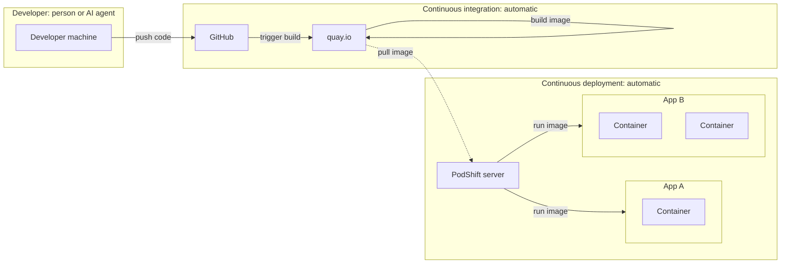

# PodShift - Kevyt CD-orkestrointi

[English](readme.md) | Suomi

Muu dokumentaatio on englanniksi.

PodShift on kevyt konttiorkestroinnin mahdollistaja pienille palvelimille. Se muuttaa minkä tahansa palvelimen, fyysisestä koneesta pilven virtuaalikoneeseen vaikkapa Hetznerillä, sellaiseksi, joka asentaa itsensä, pitää itsensä turvassa ja päivittää sovelluksesi automaattisesti, samalla asetuksella kehittäjän koneen ensimmäisestä päivästä tuotantoon asti.

Käytä mitä pilveä tahansa, tai älä käytä pilveä lainkaan. PodShift ei yksinkertaisesti koskaan sido sinua yhteen toimittajaan.

Tässä ei ole mitään taikuutta. PodShift on niin yksinkertainen, että olisit voinut rakentaa sen itse jo aikoja sitten. Se tekee sen vain puolestasi, oikealla tavalla, muutamassa minuutissa.

## Koodista tuotantoon

Lähetät koodin. Kaikki sen jälkeen tapahtuu automaattisesti.

1. Kehittäjä, ihminen tai tekoälyagentti, lähettää koodin koodialustalle, tässä GitHubiin.
2. Koodialusta käynnistää buildin konttirekisterissä, tässä quay.io:ssa, joka rakentaa imagen ja tallentaa sen.
3. PodShift-palvelin tarkkailee rekisteriä jatkuvasti. Kun uusi image ilmestyy, se hakee sen ja käynnistää sovelluksen uudelleen. Jos uusi versio osoittautuu rikkinäiseksi, se palaa vanhaan.

GitHub ja quay.io ovat vain esimerkkejä. Mikä tahansa vastaava koodialusta tai konttirekisteri käy, myös yksityinen. Suosittelemme quay.io:ta, koska se on ilmainen, siinä on paljon ominaisuuksia, ja se voi rakentaa imaget automaattisesti koodistasi.

Yksi palvelin pyörittää monia sovelluksia. Jokainen sovellus on yksi tai useampi kontti omassa yksityisessä verkossaan, joten sovellukset eivät näe toisiaan.

Commit sisään, käynnissä oleva sovellus ulos. Jatkuva käyttöönotto, ei mitään väliin.

## Suuret ongelmat, jotka PodShift ratkaisee

- Kehitys, testaus ja tuotanto eivät koskaan täysin täsmää. PodShift käyttää **samoja yksinkertaisia asetustiedostoja kaikkialla**, joten se mitä testaat, on se mikä pyörii.
- Palvelimen valmistelu konteille tarkoittaa tunteja skriptejä ja käsin tehtäviä vaiheita. PodShift tekee **koko perusasennuksen yhdellä komennolla**, joten lisäät vain sovelluksesi.
- Jatkuva käyttöönotto vaatii yleensä suuria alustoja ja asiantuntijoita. PodShift antaa **automaattiset päivitykset** yhdellä tavallisella palvelimella.
- Pilvitoimitus on kallista, ja lasku kasvaa jatkuvasti. PodShift **pyörii yhdellä edullisella palvelimella**, ilman palvelukohtaisia maksuja.
- Nykyinen toimitus tarkoittaa yleensä, että luovutat tietosi ja vapautesi yhdelle toimittajalle. PodShift toimii palvelimilla, joita hallitset itse, **ilman sidonnaisuutta**.

Pienille ja keskisuurille yrityksille suurten pilvien hallinnoidut alustat ovat liikaa. PodShift pitää olennaisen ja jättää muun pois: muutama konttisovellus muutamassa itsenäisessä ympäristössä, turvallisilla ja peruutettavissa olevilla käyttöönotoilla. Saat palvelimet, jotka turvaavat ja päivittävät itsensä, kustannuksella ja vaivalla, jonka pieni yritys jaksaa kantaa.

**PK-yritykselle oikea työkalu ei ole pienin pilvi, vaan pilvi, jota sinun ei tarvitse itse operoida.**

## CD:n todellisuus

Jokainen, joka on ajanut jatkuvaa käyttöönottoa käytännössä, tuntee sen puolen, joka harvoin päätyy esitteisiin.

**Toimitusputkesta tulee toinen tuote.** Build-työnkulut, käyttöönottoskriptit ja konttipinot vaativat jatkuvaa korjausta, muuttuvat jokaisessa julkaisussa ja riippuvat usein yhdestä tai kahdesta ihmisestä, jotka ymmärtävät ne. Tutkimus lähes 200 kypsästä hankkeesta kutsuu tätä [automaation piilokustannukseksi](https://doi.org/10.48550/arxiv.2409.02366).

**Pilvilaskua on vaikea hallita.** Pilvikulujen hallinta on suurin haaste 85 prosentille organisaatioista, ja arvioiden mukaan 29 prosenttia näistä kuluista menee hukkaan ([Flexera 2026](https://info.flexera.com/CM-REPORT-State-of-the-Cloud?lead_source=Organic+Search)).

**Lähteminen on vaikeampaa kuin saapuminen.** Ison-Britannian kilpailuviranomainen havaitsi, että alle yksi prosentti pilviasiakkaista vaihtaa toimittajaa vuodessa, koska tekniset ja kaupalliset esteet sitovat heidät ensimmäiseen valintaan ([CMA 2025](https://assets.publishing.service.gov.uk/media/688b20e6ff8c05468cb7b120/summary_of_final_decision.pdf)).

**Lähteminen voi kannattaa.** Kun 37signals siirtyi pois pilvestä omille palvelimilleen, se pudotti vuotuisen pilvilaskunsa 3,2 miljoonasta dollarista 1,3 miljoonaan samalla tiimillä ([DHH, 2024](https://world.hey.com/dhh/our-cloud-exit-savings-will-now-top-ten-million-over-five-years-c7d9b5bd)).

PodShift kulkee toista tietä. Samat Quadlet-tiedostot toimivat fyysisellä palvelimella, virtuaalikoneella tai millä tahansa hosting-tarjoajalla, kehittäjän koneen ensimmäisestä päivästä tuotantoon. Kehitä omalla laitteistolla, aja esituotanto verkossa, pidä tuotanto yksityisenä, tai siirry toiselle tarjoajalle kopioimalla tiedostosi ja tietosi. Mitään ei tarvitse kirjoittaa uusiksi.

## Tärkeimmät ominaisuudet

- **Rootless Podman -palvelin:** yhdellä RPM-asennuksella Fedora-palvelimesta tulee sellainen, joka ajaa kontteja ilman root-oikeuksia, erillisen käyttäjän alla.
- **Sisäänrakennettu kovennus:** palvelin kovennetaan asennuksen aikana, ilman lisävaiheita.
- **Drop-In Quadlets:** pudota kontti-, verkko- ja volume-tiedostot kansioon, ja PodShift tarkistaa ne ja asentaa ne palveluiksi, jotka käynnistyvät koneen käynnistyessä.
- **Palvelimen kuntotarkistus:** `podshift health-check` tarkistaa koko palvelimen ja antaa korjauksen jokaiseen ongelmaan.
- **Seuranta:** sisäänrakennetut työkalut, joilla näet, miten palvelimella menee.
- **PodShift CLI:** `podshift`-komento palvelimen arkiseen hallintaan.
- **[PodShift UI](https://github.com/vellamo-dev/cockpit-podshift) (valinnainen):** Cockpit-sivu palvelimen seurantaan selaimessa. PodShift toimii täysin ilman sitä. Katso [asennus](./docs/usage.md#podshift-ui-optional).

PodShift toimitetaan yhtenä RPM-pakettina Fedoralle. Kunkin ominaisuuden tila on [tiekartassa](./docs/roadmap.md).

## Projektin rakenne

Haluatko tutustua tarkemmin? Projekti on jaettu alla oleviin osiin, joten voit hypätä suoraan siihen, mikä sinua kiinnostaa.

- [docs/](./docs) - mitä PodShift on, miten sitä käytetään ja miksi se on olemassa.
- [src/server/](./src/server) - itse sovellus: skriptit, asetukset ja mallit, jotka asennetaan palvelimelle.
- [src/deployment/](./src/deployment) - RPM Stager: muuttaa sovelluksen asennettavaksi paketiksi.
- [src/test/](./src/test) - Test Lab: sovelluksen rakentaminen ja testaus.
- [.run/](./.run) - IDE-oikopolut rakentamiseen ja testaukseen.

## Dokumentaatio

Asennus, käyttö, rajaus ja kaikki muu on [dokumentaatiossa](./docs/readme.md).

Tietoturvakäytäntö on tiedostossa [security.md](./security.md).
