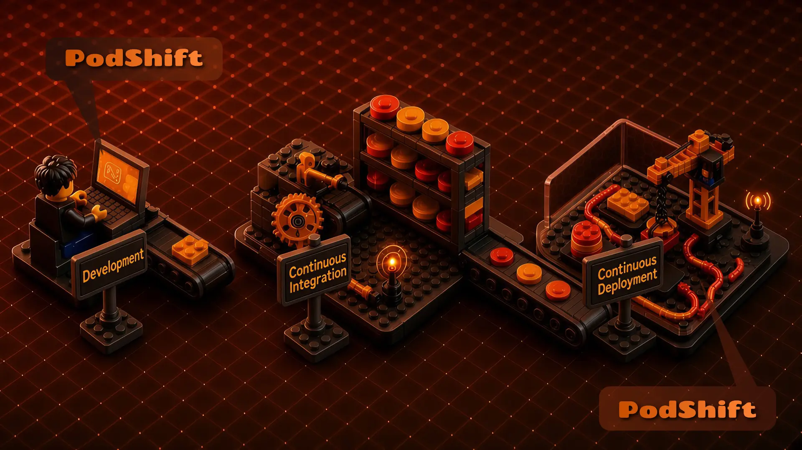

# PodShift - Kevyt CD-orkestrointi

[English](readme.md) | Suomi

Muu dokumentaatio on englanniksi.

Olet rakentanut sovelluksen. Nyt sen pitää pyöriä jossain, pysyä turvassa ja päivittyä aina, kun parannat sitä. Siihen moni tiimi jää jumiin: joko palvelimia päivitetään käsin, tai päädytään monimutkaisiin pilvialustoihin, joita ei oikeasti tarvittu.

PodShift asettuu näiden väliin. Asenna se yhdelle tavalliselle palvelimelle, ja palvelin asentaa itsensä, pitää itsensä turvassa ja päivittää sovelluksesi itse. Se toimii samalla tavalla työpöytäkoneellasi, toimiston pienellä koneella tai millä tahansa hosting-tarjoajalla.

Ei taikuutta eikä sidonnaisuutta. PodShift käyttää Linuxin vakiotyökaluja, ja voisit rakentaa kaiken itsekin. Se vain tekee sen puolestasi, oikealla tavalla, muutamassa minuutissa.

PodShift ei lisää palvelimelle raskasta taustapalvelua. Se rakentaa ympäristön ja jättää palvelimen resurssit sovelluksillesi.

## Näin koodisi päätyy palvelimelle

Monella palvelimella sovelluksia ajetaan yhä perinteiseen tapaan: joku kirjautuu sisään, kopioi tiedostot, asentaa sovelluksen tarvitsemat asiat ja käynnistää sen uudelleen. Se toimii, mutta jokainen palvelin muuttuu vähitellen erilaiseksi, päivitykset pelottavat, ja vain yksi ihminen tietää, miten kaikki tehtiin.

Kontit muuttavat tämän. Idea selkokielellä:

- **Image:** sovelluksesi pakattuna yhteen kaiken sen kanssa, mitä se tarvitsee toimiakseen, kuten oikeat kirjastot ja asetukset. Se on kuin suljettu laatikko, jonka resepti antaa aina saman tuloksen. Rakennat sen kerran, eikä se enää muutu.
- **Kontti:** käynnissä oleva image. Samasta imagesta voi käynnistää monta konttia, työpöytäkoneella tai palvelimella, ja ne toimivat kaikkialla samoin.
- **Rekisteri:** hylly, jolla imaget säilytetään, jotta palvelimet voivat hakea ne.

Koska image on kaikkialla sama, "toimii minun koneellani" tarkoittaa vihdoin, että se toimii myös palvelimella.

**CI/CD** on automaattinen polku koodistasi käynnissä olevaksi kontiksi:

1. **Kehitys:** kirjoitat koodia omalla koneellasi. Kun PodShift on työpöytäkoneellasi tai pienellä paikallisella palvelimella, saat oman testipalvelimen muutamassa minuutissa. Kokeile, miten sovelluksesi pakataan kontteihin, yhdistä useita kontteja yhdeksi sovellukseksi, tai pystytä nopeasti tietokanta, testiympäristö tai mitä ikinä työssäsi tarvitset. Kaikki toimii juuri niin kuin tuotannossa. Kun ideasi toimii, lähetä koodi koodialustalle, kuten GitHubiin.
2. **Jatkuva integraatio (CI):** palvelu rakentaa koodistasi uuden imagen ja vie sen rekisterin hyllylle.
3. **Jatkuva käyttöönotto (CD):** palvelimesi, jossa myös on PodShift, huomaa uuden imagen, käynnistää sen konttina ja palaa vanhaan, jos jokin menee rikki.

**Mihin PodShift sopii.** PodShift on yksinkertaisin tapa siirtyä perinteisestä tavasta imageihin, kontteihin ja CI/CD:hen. Se on mukana polun molemmissa päissä: omalla koneellasi, jotta voit kokeilla ideoita turvallisesti, ja palvelimella, jossa se ajaa sovelluksesi ja pitää ne ajan tasalla. Samat tiedostot toimivat molemmissa paikoissa, joten se mitä testasit, on se mikä pyörii. Ei Kubernetesia, ei klusteria eikä suurta pilvialustaa: vain tavallisia koneita ja muutama tiedosto, jotka voit lukea.

Työpöytäkoneella PodShift on myös yksinkertaisesti kätevä paikallinen testipalvelin: pystytä mitä tarvitset, kokeile ja heitä pois.

Haluatko teknisen näkymän? Katso [tarkempi kuvaus](./docs/readme.md#from-push-to-production) (englanniksi).

## Suuret ongelmat, jotka PodShift ratkaisee

- Kehitys, testaus ja tuotanto eivät koskaan täysin täsmää. PodShift käyttää **samoja yksinkertaisia asetustiedostoja kaikkialla**, joten se mitä testaat, on se mikä pyörii.
- Palvelimen valmistelu konteille tarkoittaa tunteja skriptejä ja käsin tehtäviä vaiheita. PodShift tekee **koko perusasennuksen yhdellä komennolla**, joten lisäät vain sovelluksesi.
- Jatkuva käyttöönotto vaatii yleensä suuria alustoja ja asiantuntijoita. PodShift antaa **automaattiset päivitykset** yhdellä tavallisella palvelimella.
- Pilvitoimitus on kallista, ja lasku kasvaa jatkuvasti. PodShift **pyörii yhdellä edullisella palvelimella**, ilman palvelukohtaisia maksuja.
- Nykyinen toimitus tarkoittaa yleensä, että luovutat tietosi ja vapautesi yhdelle toimittajalle. PodShift toimii palvelimilla, joita hallitset itse, **ilman sidonnaisuutta**.

Pienille ja keskisuurille yrityksille suurten pilvien hallinnoidut alustat ovat liikaa. PodShift pitää olennaisen ja jättää muun pois: muutama konttisovellus muutamassa itsenäisessä ympäristössä, turvallisilla ja peruutettavissa olevilla käyttöönotoilla. Saat palvelimet, jotka turvaavat ja päivittävät itsensä, kustannuksella ja vaivalla, jonka pieni yritys jaksaa kantaa.

**PK-yritykselle oikea työkalu ei ole pienin pilvi, vaan pilvi, jota sinun ei tarvitse itse operoida.**

## CD:n todellisuus

Jokainen, joka on ajanut jatkuvaa käyttöönottoa käytännössä, tuntee sen puolen, joka harvoin päätyy esitteisiin.

**Toimitusputkesta tulee toinen tuote.** Build-työnkulut, käyttöönottoskriptit ja konttipinot vaativat jatkuvaa korjausta, muuttuvat jokaisessa julkaisussa ja riippuvat usein yhdestä tai kahdesta ihmisestä, jotka ymmärtävät ne. Tutkimus lähes 200 kypsästä hankkeesta kutsuu tätä [automaation piilokustannukseksi](https://doi.org/10.48550/arxiv.2409.02366).

**Pilvilaskua on vaikea hallita.** Pilvikulujen hallinta on suurin haaste 85 prosentille organisaatioista, ja arvioiden mukaan 29 prosenttia näistä kuluista menee hukkaan ([Flexera 2026](https://info.flexera.com/CM-REPORT-State-of-the-Cloud?lead_source=Organic+Search)).

**Lähteminen on vaikeampaa kuin saapuminen.** Ison-Britannian kilpailuviranomainen havaitsi, että alle yksi prosentti pilviasiakkaista vaihtaa toimittajaa vuodessa, koska tekniset ja kaupalliset esteet sitovat heidät ensimmäiseen valintaan ([CMA 2025](https://assets.publishing.service.gov.uk/media/688b20e6ff8c05468cb7b120/summary_of_final_decision.pdf)).

**Lähteminen voi kannattaa.** Kun 37signals siirtyi pois pilvestä omille palvelimilleen, se pudotti vuotuisen pilvilaskunsa 3,2 miljoonasta dollarista 1,3 miljoonaan samalla tiimillä ([DHH, 2024](https://world.hey.com/dhh/our-cloud-exit-savings-will-now-top-ten-million-over-five-years-c7d9b5bd)).

PodShift kulkee toista tietä. Samat Quadlet-tiedostot toimivat fyysisellä palvelimella, virtuaalikoneella tai millä tahansa hosting-tarjoajalla, kehittäjän koneen ensimmäisestä päivästä tuotantoon. Kehitä omalla laitteistolla, aja esituotanto verkossa, pidä tuotanto yksityisenä, tai siirry toiselle tarjoajalle kopioimalla tiedostosi ja tietosi. Mitään ei tarvitse kirjoittaa uusiksi.

## Tärkeimmät ominaisuudet

- **Rootless Podman -palvelin:** yhdellä RPM-asennuksella Fedora-palvelimesta tulee sellainen, joka ajaa kontteja ilman root-oikeuksia, erillisen käyttäjän alla.
- **Sisäänrakennettu kovennus:** palvelin kovennetaan asennuksen aikana, ilman lisävaiheita.
- **Drop-In Quadlets:** pudota kontti-, verkko- ja volume-tiedostot kansioon, ja PodShift tarkistaa ne ja asentaa ne palveluiksi, jotka käynnistyvät koneen käynnistyessä.
- **Palvelimen kuntotarkistus:** `podshift health-check` tarkistaa koko palvelimen ja antaa korjauksen jokaiseen ongelmaan.
- **Seuranta:** sisäänrakennetut työkalut, joilla näet, miten palvelimella menee.
- **PodShift CLI:** `podshift`-komento palvelimen arkiseen hallintaan.
- **[PodShift UI](https://github.com/vellamo-dev/cockpit-podshift) (valinnainen):** Cockpit-sivu palvelimen seurantaan selaimessa. PodShift toimii täysin ilman sitä. Katso [asennus](./docs/usage.md#podshift-ui-optional).

PodShift toimitetaan yhtenä RPM-pakettina Fedoralle. Kunkin ominaisuuden tila on [tiekartassa](./docs/roadmap.md).

## Projektin rakenne

Haluatko tutustua tarkemmin? Projekti on jaettu alla oleviin osiin, joten voit hypätä suoraan siihen, mikä sinua kiinnostaa.

- [docs/](./docs) - mitä PodShift on, miten sitä käytetään ja miksi se on olemassa.
- [src/server/](./src/server) - itse sovellus: skriptit, asetukset ja mallit, jotka asennetaan palvelimelle.
- [src/deployment/](./src/deployment) - RPM Stager: muuttaa sovelluksen asennettavaksi paketiksi.
- [src/test/](./src/test) - Test Lab: sovelluksen rakentaminen ja testaus.
- [.run/](./.run) - IDE-oikopolut rakentamiseen ja testaukseen.

## Dokumentaatio

Asennus, käyttö, rajaus ja kaikki muu on [dokumentaatiossa](./docs/readme.md).

Tietoturvakäytäntö on tiedostossa [security.md](./security.md).
