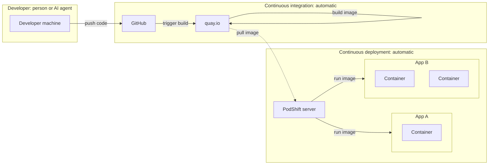

# PodShift - Lightweight CD Orchestration

PodShift is a lightweight container orchestration enabler for small servers. It turns any server, from bare metal to a cloud VM at a provider like Hetzner, into one that sets itself up, keeps itself secure, and updates your apps automatically, with the same configuration from the first day on a developer's computer all the way to production.

Use any cloud you like, or none at all. PodShift simply never locks you in.

There is no magic here. PodShift is so simple you could have built it yourself long ago. It just does it for you, the right way, in minutes.

## From Push to Production

You push code. Everything after that is automatic.

1. The developer, a person or an AI agent, pushes code to a code platform, here GitHub.
2. The code platform triggers a build on the container registry, here quay.io, which builds the image and stores it.
3. The PodShift server constantly watches the registry. When a new image appears, it pulls it and restarts the app. If the new version turns out broken, it goes back to the old one.

GitHub and quay.io are just examples. Any similar code platform or container registry works, including a private one. We recommend quay.io because it's free, has a lot of features, and can build images automatically from your code.

One server runs many apps. Each app is one or more containers on its own private network, so apps don't see each other.

Commit in, running app out. Continuous deployment, nothing in between.

## Big Problems PodShift Solves

- Development, testing, and production never quite match. PodShift uses the **same simple configuration files everywhere**, so what you test is what runs.
- Setting up a server for containers means hours of scripts and manual steps. PodShift does the **whole base setup with one command**, so you only add your apps.
- Continuous deployment usually needs big platforms and specialists. PodShift gives you **automatic updates** on one ordinary server.
- Cloud delivery is expensive, and the bill keeps growing. PodShift **runs on one affordable server**, with no per-service fees.
- Modern delivery usually means handing your data and your freedom to one vendor. PodShift runs on servers you control, with **no lock-in**.

For small and medium businesses, the big clouds' managed platforms are overkill. PodShift keeps the essentials and leaves out the rest: a few containerized apps across a few independent environments, with safe, reversible deploys. That gives you servers that secure and update themselves, at a cost and effort a small business can sustain.

**For SMBs, the right tool is not the smallest cloud; it is the cloud you don't have to operate.**

## CD Reality

Anyone who has run continuous deployment in practice knows the part that rarely makes it into the brochures.

**The pipeline becomes a second product.** Build workflows, deploy scripts, and container stacks need constant fixing, change with every release, and often depend on one or two people who understand them. Research on almost 200 mature projects calls this [the hidden cost of automation](https://doi.org/10.48550/arxiv.2409.02366).

**The cloud bill is hard to control.** Managing cloud spend is the top challenge for 85% of organizations, and an estimated 29% of that spend is wasted ([Flexera 2026](https://info.flexera.com/CM-REPORT-State-of-the-Cloud?lead_source=Organic+Search)).

**Leaving is harder than arriving.** The UK competition authority found that fewer than 1% of cloud customers switch provider each year, because technical and commercial barriers lock them into their first choice ([CMA 2025](https://assets.publishing.service.gov.uk/media/688b20e6ff8c05468cb7b120/summary_of_final_decision.pdf)).

**Leaving can pay off.** After moving off the cloud to its own servers, 37signals cut its yearly cloud bill from $3.2 million to $1.3 million with the same team ([DHH, 2024](https://world.hey.com/dhh/our-cloud-exit-savings-will-now-top-ten-million-over-five-years-c7d9b5bd)).

PodShift takes a different path. The same Quadlet files run on bare metal, on a virtual machine, or at any hosting provider, from the first day on a developer's computer to production. Develop on in-house hardware, stage online, run production privately, or move to another provider by copying your files and data. Nothing needs to be rewritten.

## Main Features

- **Rootless Podman Server:** one RPM install turns a Fedora server into one that runs containers without root, under a dedicated user.
- **Built-in Hardening:** the server is hardened during install, with no extra steps.
- **Drop-In Quadlets:** drop container, network and volume files into a folder, and PodShift checks them and installs them as services that start at boot.
- **Server Health Check:** `podshift health-check` checks the whole server and gives a fix for each problem.
- **Monitoring:** built-in tools to see how the server is doing.
- **PodShift CLI:** the `podshift` command for everyday server management.

PodShift ships as a single RPM for Fedora. The status of each feature is in the [roadmap](./docs/roadmap.md).

## Project Structure

Want to dig deeper? The project is divided into the parts below, so feel free to jump straight to the one that interests you.

- [docs/](./docs) - what PodShift is, how to use it, and why it exists.
- [src/server/](./src/server) - the application itself: the scripts, configuration, and templates installed on the server.
- [src/deployment/](./src/deployment) - RPM Stager: turns the application into an installable package.
- [src/test/](./src/test) - Test Lab: building and testing the application.
- [.run/](./.run) - IDE shortcuts for building and testing.

## Documentation

Installation, usage, scope and everything else are in the [documentation](./docs/readme.md).
