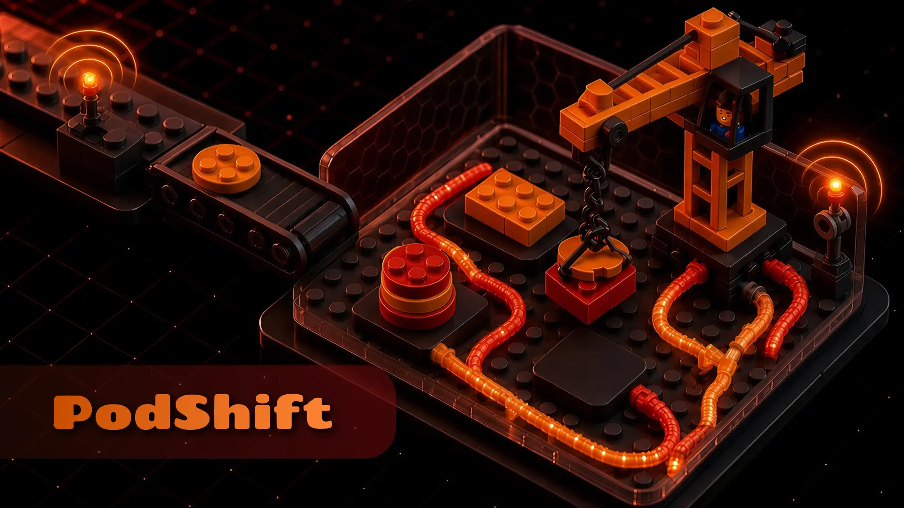
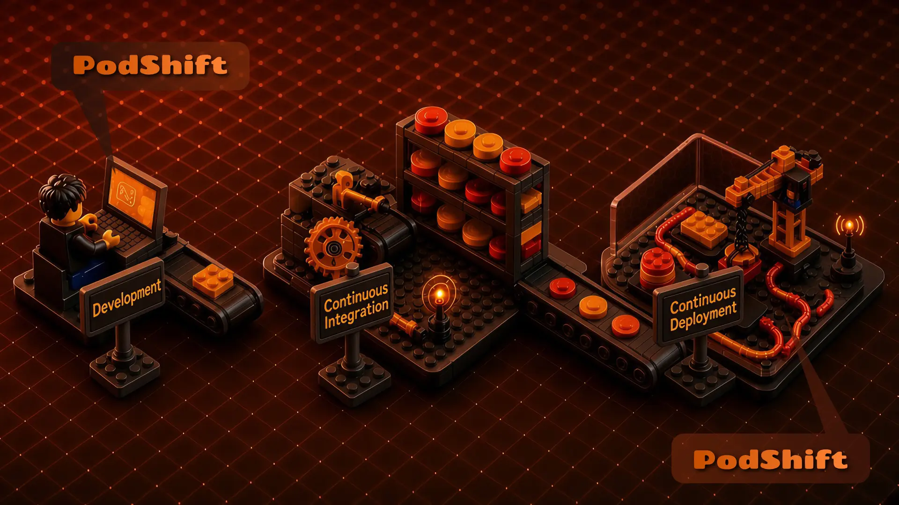

# PodShift - Lightweight CD Orchestration

English | [Suomi](readme.fi.md)

You've built an app. Now it needs to run somewhere, stay safe, and get updated every time you improve it. That's where many teams get stuck: either they update servers by hand, or they end up with complex cloud platforms they didn't really need.

PodShift sits in between. Install it on one ordinary server, and that server sets itself up, keeps itself secure, and updates your apps on its own. It works the same on your desktop, on a small machine at the office, or at any hosting provider.

There's no magic and no lock-in. PodShift uses standard Linux tools, and you could build all of it yourself. It just does it for you, the right way, in minutes.

## How Your Code Gets to the Server

Many servers still run apps the classic way: someone logs in, copies files, installs what the app needs, and restarts it. It works, but every server slowly becomes different, updates are scary, and only one person knows how it was done.

Containers change that. Here's the idea in plain words:

- **Image:** your app packed together with everything it needs to run, such as the right libraries and settings. It's like a sealed box with a recipe that always gives the same result. You build it once, and it never changes.
- **Container:** an image that is running. You can start many containers from the same image, on your desktop or on a server, and they behave the same everywhere.
- **Registry:** a shelf where images are stored, so servers can fetch them.

Because the image is the same everywhere, "it works on my machine" finally means it works on the server too.

**CI/CD** is the automatic path from your code to a running container:

1. **Development:** you write code on your own computer. With PodShift on your desktop or a small local server, you get your own test server in minutes. Try out how to pack your app into containers, combine several containers into one app, or quickly set up a database, a test environment, or whatever your work needs. Everything runs just as it will in production. When your idea works, push the code to a code platform such as GitHub.
2. **Continuous Integration (CI):** a service builds a new image from your code and puts it on the registry shelf.
3. **Continuous Deployment (CD):** your server, also running PodShift, notices the new image, starts it as a container, and goes back to the old one if something breaks.

**Where PodShift fits.** PodShift is the simplest way to move from the classic way to images, containers and CI/CD. It's there at both ends of the path: on your own machine, so you can try ideas safely, and on the server, where it runs your apps and keeps them updated. The same files work in both places, so what you tested is what runs. No Kubernetes, no cluster and no big cloud platform: just ordinary machines and a few files you can read.

On your desktop, PodShift is also simply a handy local test server: spin up what you need, try it, and throw it away.

Want the technical view? See [how it works in detail](./docs/readme.md#from-push-to-production).

## Big Problems PodShift Solves

- Development, testing, and production never quite match. PodShift uses the **same simple configuration files everywhere**, so what you test is what runs.
- Setting up a server for containers means hours of scripts and manual steps. PodShift does the **whole base setup with one command**, so you only add your apps.
- Continuous deployment usually needs big platforms and specialists. PodShift gives you **automatic updates** on one ordinary server.
- Cloud delivery is expensive, and the bill keeps growing. PodShift **runs on one affordable server**, with no per-service fees.
- Modern delivery usually means handing your data and your freedom to one vendor. PodShift runs on servers you control, with **no lock-in**.

For small and medium businesses, the big clouds' managed platforms are overkill. PodShift keeps the essentials and leaves out the rest: a few containerized apps across a few independent environments, with safe, reversible deploys. That gives you servers that secure and update themselves, at a cost and effort a small business can sustain.

**For SMBs, the right tool is not the smallest cloud; it is the cloud you don't have to operate.**

## CD Reality

Anyone who has run continuous deployment in practice knows the part that rarely makes it into the brochures.

**The pipeline becomes a second product.** Build workflows, deploy scripts, and container stacks need constant fixing, change with every release, and often depend on one or two people who understand them. Research on almost 200 mature projects calls this [the hidden cost of automation](https://doi.org/10.48550/arxiv.2409.02366).

**The cloud bill is hard to control.** Managing cloud spend is the top challenge for 85% of organizations, and an estimated 29% of that spend is wasted ([Flexera 2026](https://info.flexera.com/CM-REPORT-State-of-the-Cloud?lead_source=Organic+Search)).

**Leaving is harder than arriving.** The UK competition authority found that fewer than 1% of cloud customers switch provider each year, because technical and commercial barriers lock them into their first choice ([CMA 2025](https://assets.publishing.service.gov.uk/media/688b20e6ff8c05468cb7b120/summary_of_final_decision.pdf)).

**Leaving can pay off.** After moving off the cloud to its own servers, 37signals cut its yearly cloud bill from $3.2 million to $1.3 million with the same team ([DHH, 2024](https://world.hey.com/dhh/our-cloud-exit-savings-will-now-top-ten-million-over-five-years-c7d9b5bd)).

PodShift takes a different path. The same Quadlet files run on bare metal, on a virtual machine, or at any hosting provider, from the first day on a developer's computer to production. Develop on in-house hardware, stage online, run production privately, or move to another provider by copying your files and data. Nothing needs to be rewritten.

## Main Features

- **Rootless Podman Server:** one RPM install turns a Fedora server into one that runs containers without root, under a dedicated user.
- **Built-in Hardening:** the server is hardened during install, with no extra steps.
- **Drop-In Quadlets:** drop container, network and volume files into a folder, and PodShift checks them and installs them as services that start at boot.
- **Server Health Check:** `podshift health-check` checks the whole server and gives a fix for each problem.
- **Monitoring:** built-in tools to see how the server is doing.
- **PodShift CLI:** the `podshift` command for everyday server management.
- **[PodShift UI](https://github.com/vellamo-dev/cockpit-podshift) (optional):** a Cockpit page for monitoring the server in a browser. PodShift works fully without it. See [install](./docs/usage.md#podshift-ui-optional).

PodShift ships as a single RPM for Fedora. The status of each feature is in the [roadmap](./docs/roadmap.md).

## Project Structure

Want to dig deeper? The project is divided into the parts below, so feel free to jump straight to the one that interests you.

- [docs/](./docs) - what PodShift is, how to use it, and why it exists.
- [src/server/](./src/server) - the application itself: the scripts, configuration, and templates installed on the server.
- [src/deployment/](./src/deployment) - RPM Stager: turns the application into an installable package.
- [src/test/](./src/test) - Test Lab: building and testing the application.
- [.run/](./.run) - IDE shortcuts for building and testing.

## Documentation

Installation, usage, scope and everything else are in the [documentation](./docs/readme.md).

The security policy is in [security.md](./security.md).
